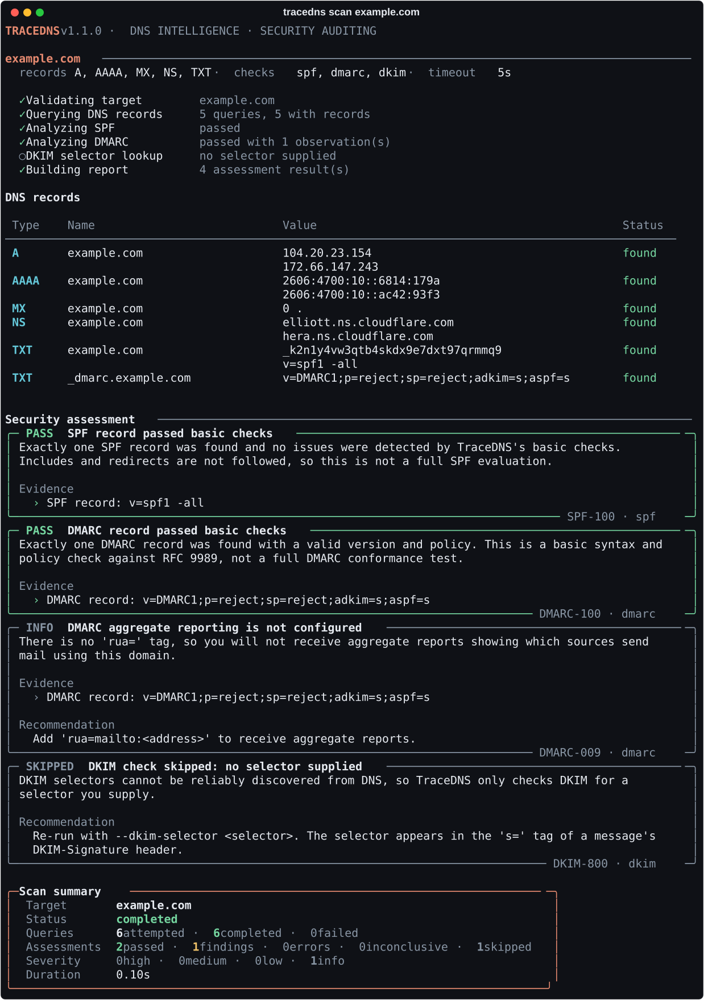
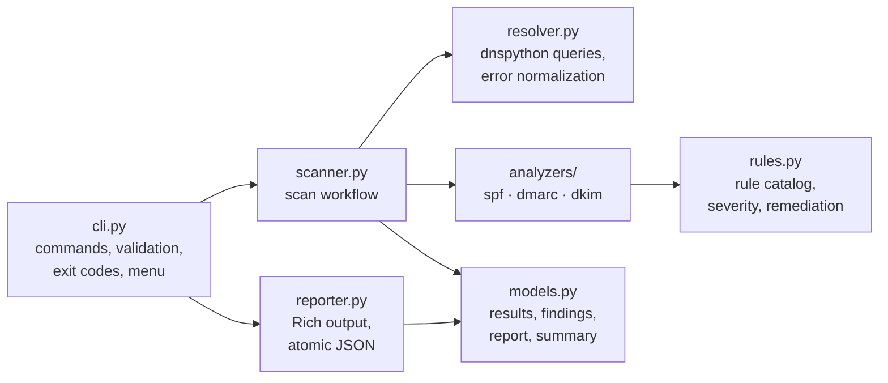
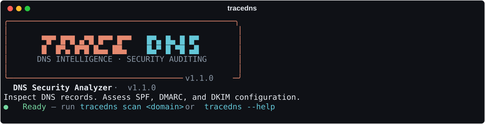
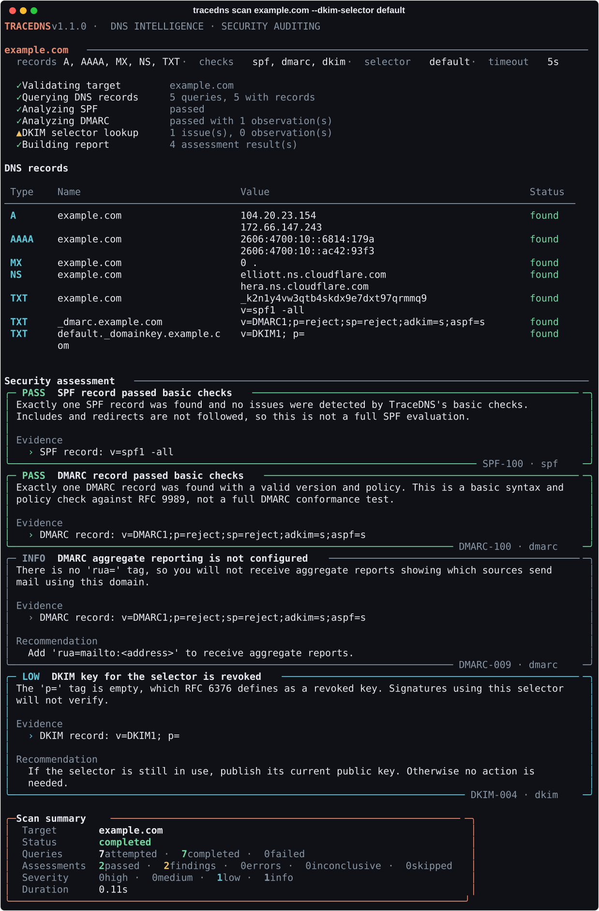
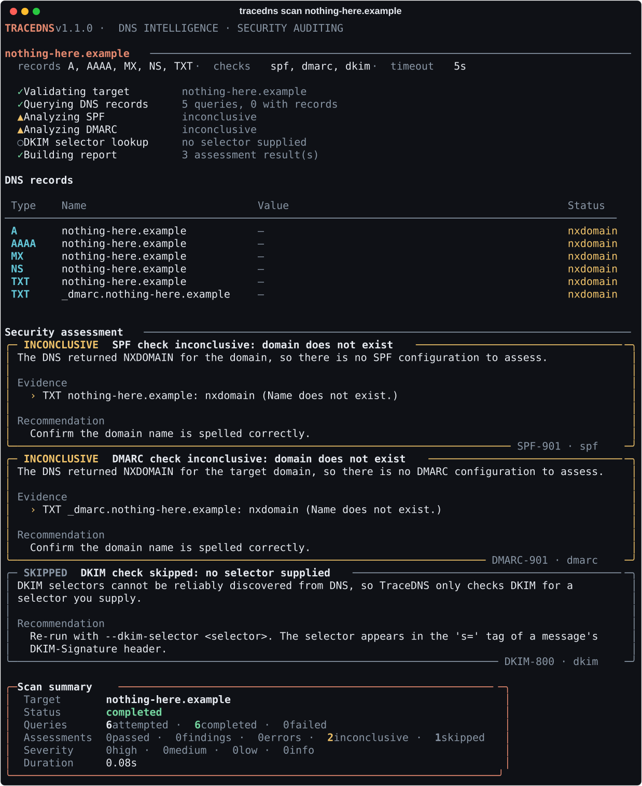
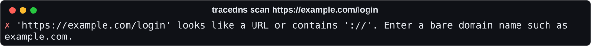

# TraceDNS

[](https://github.com/PranavY-01/TraceDNS/actions/workflows/ci.yml)


**A modular Python-based cybersecurity utility for DNS record analysis and evidence-based assessment of domain and email-security configurations.**

TraceDNS queries a domain's `A`, `AAAA`, `MX`, `NS`, and `TXT` records, runs basic SPF and DMARC checks, and optionally looks up a DKIM key for a selector you supply. Each result quotes the DNS data it is based on, has a transparent severity, and comes with a remediation recommendation. Results are shown in a Rich-powered terminal interface and can be exported as JSON.

It is intended for cybersecurity students, system administrators, and authorized security testers.

> **New to TraceDNS?** The [user guide](docs/user-guide.md) explains what it checks, how to run it, and how to read the results, in plain language.
>
> **Developer?** The [developer demo guide](docs/demo-guide.md) walks through every feature alongside the code and tests behind it. The design is described in [docs/architecture.md](docs/architecture.md), and changes are listed in the [changelog](CHANGELOG.md).



---

## Contents

- [Problem statement](#problem-statement)
- [Aim and objectives](#aim-and-objectives)
- [Features](#features)
- [Scope](#scope)
- [Architecture](#architecture)
- [Technology stack](#technology-stack)
- [Installation](#installation)
- [Usage](#usage)
- [CLI reference](#cli-reference)
- [Sample output](#sample-output)
- [JSON report](#json-report)
- [Running tests](#running-tests)
- [Known limitations](#known-limitations)
- [Responsible use](#responsible-use)
- [License](#license)

## Problem statement

Email spoofing remains a common starting point for phishing. SPF, DMARC, and DKIM let domain owners publish policies that help receivers detect forged mail, but these policies live in DNS TXT records that are easy to get wrong. Common mistakes include two SPF records where one is required, a DMARC policy with an invalid tag, or a DKIM key that was revoked and never replaced. These mistakes are rarely visible until mail is spoofed or rejected.

TraceDNS gives a quick, readable, evidence-backed view of these configurations. It also states clearly where its checks stop.

## Aim and objectives

**Aim:** a lightweight, reliable DNS security assessment tool that identifies common DNS configuration weaknesses and email-authentication policy issues.

1. Retrieve A, AAAA, MX, NS, and TXT records.
2. Perform basic SPF and DMARC configuration checks.
3. Support optional DKIM record lookups using a user-supplied selector.
4. Identify missing records, malformed configurations, and duplicate SPF records.
5. Classify findings and provide evidence-based remediation advice.
6. Display results through Rich and export structured JSON.
7. Handle DNS errors predictably, and test the application with pytest.
8. Provide reproducible installation and usage instructions.

## Features

- **DNS record lookup** for `A`, `AAAA`, `MX`, `NS`, and `TXT`, with finite, configurable timeouts.
- **Precise query outcomes:** records found, no records (`NOERROR`/no data), `NXDOMAIN`, timeout, `SERVFAIL`, `REFUSED`, and other errors are all reported separately. A missing record is never confused with a failed query.
- **Basic SPF checks (RFC 7208):** presence, multiple records, term syntax (mechanisms, qualifiers, `ip4`/`ip6` networks, CIDR lengths, duplicate modifiers), the `all` qualifier, missing `all`/`redirect`, terms after `all`, use of `ptr`, and more than 10 DNS-lookup terms at the top level.
- **Basic DMARC checks (RFC 9989):** presence, duplicate records, the version tag, and the `p`/`sp`/`np` policy values. Also checks malformed or duplicate tags, `adkim`/`aspf`/`t`/`psd`/`fo` values, and `rua`/`ruf` reporting URIs. Reports observations for `p=none`, missing `rua`, weaker `sp`/`np` policies, test mode (`t=y`), and the legacy tags RFC 9989 removed (`pct`, `rf`, `ri`).
- **Optional DKIM lookup (RFC 6376)** at `<selector>._domainkey.<domain>`: key presence, revoked keys, malformed tags, unknown key types, and testing mode. The key itself is parsed: unusable keys are flagged, and RSA key sizes are judged against RFC 8301 (under 1024 bits is rejected by verifiers; under 2048 bits is weak).
- **Structured findings** with a stable ID, rule ID, status, severity, evidence, and recommendation. Severity comes from a central rule catalog, not from the UI.
- **Branded terminal interface:** banner, live stage progress, records table, finding panels, and a summary. Colors adapt to the terminal and output stays readable when redirected.
- **Interactive welcome menu** when run with no command in a terminal.
- **JSON export** to a file (written atomically, never silently overwritten) or to stdout in a JSON-only mode for scripts.
- **Meaningful exit codes** that separate "issues found" from "the scan itself failed".
- **Choice of resolver** with `--nameserver`, for comparing what different resolvers see.
- **A published JSON Schema** ([`schema/report-1.1.json`](schema/report-1.1.json)) that the test suite validates reports against.

## Scope

**Included in V1:** everything listed under [Features](#features).

**Explicitly excluded from V1:**

- Full DNSSEC chain-of-trust validation
- Exhaustive SPF evaluation (following `include`/`redirect`, counting lookups inside included records, macro expansion)
- Complete DMARC conformance testing and the RFC 9989 DNS tree walk to the organizational domain
- Automatic DKIM selector discovery
- Zone transfers, subdomain enumeration, exploitation, or takeover attempts
- Web dashboard, API, database, scan history, monitoring, or alerting
- SIEM integration, threat-intelligence enrichment, and AI or opaque risk scoring

## Architecture



| Module | Responsibility |
|---|---|
| `cli.py` | Typer commands, option parsing, input validation, exit codes, welcome menu |
| `scanner.py` | Runs the queries each check needs (each once), applies analyzers, builds the report |
| `resolver.py` | Domain and selector validation, DNS queries, mapping every outcome to a status |
| `analyzers/spf.py` | Basic SPF checks (RFC 7208) |
| `analyzers/dmarc.py` | Basic DMARC checks (RFC 9989) |
| `analyzers/dkim.py` | Selector-based DKIM lookup, key-record checks, and key parsing (RFC 6376, RFC 8301) |
| `rules.py` | Central catalog of rule IDs, statuses, severities, and recommendations |
| `models.py` | Dataclasses for DNS results, findings, and reports; summary counts |
| `reporter.py` | Banner, progress, tables, panels, summary, and JSON serialization |

Analyzers and the resolver never print. The reporter never queries DNS or assigns severity. See [docs/architecture.md](docs/architecture.md) for the data flow, schemas, error semantics, and full rule catalog.

```text
TraceDNS/
├── src/tracedns/
│   ├── __init__.py
│   ├── cli.py
│   ├── scanner.py
│   ├── resolver.py
│   ├── models.py
│   ├── rules.py
│   ├── reporter.py
│   └── analyzers/
│       ├── __init__.py
│       ├── common.py
│       ├── spf.py
│       ├── dmarc.py
│       └── dkim.py
├── tests/                          # offline test suite (no network)
├── schema/report-1.1.json          # JSON Schema for reports
├── examples/sample-report.json     # illustrative report from test fixtures
├── scripts/
│   ├── capture_screenshots.py      # regenerates docs/images/ from live runs
│   └── generate_sample_report.py   # regenerates the sample report
├── docs/
│   ├── user-guide.md
│   ├── demo-guide.md
│   ├── architecture.md
│   └── images/                     # screenshots
├── .github/workflows/ci.yml        # lint + tests on Python 3.11–3.13
├── pyproject.toml
├── CHANGELOG.md
├── README.md
└── LICENSE
```

## Technology stack

| Technology | Purpose |
|---|---|
| [Python](https://www.python.org/) 3.11+ | Core language |
| [Typer](https://typer.tiangolo.com/) | CLI commands and options |
| [Rich](https://rich.readthedocs.io/) | Terminal presentation |
| [dnspython](https://www.dnspython.org/) | DNS resolution |
| [pytest](https://docs.pytest.org/) | Automated tests (development) |
| [Ruff](https://docs.astral.sh/ruff/) | Linting and formatting (development) |
| [jsonschema](https://python-jsonschema.readthedocs.io/) | Validating reports against the published schema in tests (development) |
| [GitHub Actions](https://docs.github.com/actions) | CI: lint and tests on Python 3.11–3.13, Ubuntu and Windows |

JSON serialization and DKIM key parsing use the standard library. There are no other runtime dependencies.

## Installation

### Prerequisites

- Python **3.11 or newer**
- `git`
- Network access to a DNS resolver (only for real scans, not for the test suite)

### Windows (PowerShell)

```powershell
git clone https://github.com/PranavY-01/TraceDNS.git
cd TraceDNS
python -m venv .venv
.venv\Scripts\Activate.ps1
python -m pip install --upgrade pip
python -m pip install -e ".[dev]"
```

If PowerShell blocks the activation script, run `Set-ExecutionPolicy -Scope CurrentUser RemoteSigned` once, or call `.venv\Scripts\python.exe` directly.

### Linux and macOS

```bash
git clone https://github.com/PranavY-01/TraceDNS.git
cd TraceDNS
python3 -m venv .venv
source .venv/bin/activate
python -m pip install --upgrade pip
python -m pip install -e ".[dev]"
```

`.[dev]` also installs pytest, Ruff, and jsonschema. To install only the runtime dependencies, use `python -m pip install -e .`.

Confirm the install:

```bash
tracedns --version
```

## Usage

```bash
# Welcome screen (interactive menu when run in a terminal)
tracedns

# Default scan: all record types, SPF and DMARC (DKIM is skipped without a selector)
tracedns scan example.com

# Query selected record types (comma-separated or repeated)
tracedns scan example.com --record A,MX
tracedns scan example.com -r A -r AAAA

# Run selected checks, or none for a records-only lookup
tracedns scan example.com --checks spf,dmarc
tracedns scan example.com --checks none

# Look up a DKIM key for a known selector
tracedns scan example.com --dkim-selector selector1

# Save a JSON report (refuses to replace an existing file without --overwrite)
tracedns scan example.com --json report.json
tracedns scan example.com --json report.json --overwrite

# JSON only, on stdout, for scripts and pipelines
tracedns scan example.com --json - > report.json

# Ask a specific resolver instead of the system one (IP addresses only)
tracedns scan example.com --nameserver 1.1.1.1
tracedns scan example.com -n 9.9.9.9,2620:fe::fe
```

**Input rules.** TraceDNS accepts bare, fully qualified domain names. Input is case-insensitive, a trailing dot is allowed, and internationalized names are converted to their `xn--` form. URLs, paths, ports, e-mail addresses, IP addresses, and single-label names (such as `localhost` or internal hostnames) are rejected.

**Finding your DKIM selector.** Open the headers of a message sent from the domain and find the `DKIM-Signature` header. The selector is the value of its `s=` tag.

### Interactive menu

Running `tracedns` (or `tracedns welcome`) in a terminal shows the banner and a menu:

1. **Scan a domain:** prompts for a domain and an optional DKIM selector, then runs the default scan.
2. **Inspect DNS records:** prompts for a domain and queries records only.
3. **Help and usage:** shows the command reference and exit codes.
4. **Exit**

Invalid answers are re-asked, a blank domain returns to the menu, and Ctrl+C exits cleanly. When stdin or stdout is not a terminal, TraceDNS prints the banner and exits without waiting for input.

For a non-technical walkthrough, see the [user guide](docs/user-guide.md). For a feature-by-feature tour that maps each behaviour to its code and tests, see the [developer demo guide](docs/demo-guide.md).

## CLI reference

```text
tracedns [--version | -V] [--help | -h]
tracedns welcome
tracedns scan DOMAIN [OPTIONS]
```

| Option | Description | Default |
|---|---|---|
| `-r, --record TYPES` | Record types: `A`, `AAAA`, `MX`, `NS`, `TXT`. Comma-separated or repeated. | all five |
| `-c, --checks CHECKS` | Checks: `spf`, `dmarc`, `dkim`, or `none`. Comma-separated or repeated. | `spf,dmarc,dkim` |
| `-s, --dkim-selector SELECTOR` | DKIM selector to look up. Adds the `dkim` check. | none (DKIM skipped) |
| `-j, --json PATH` | Write a JSON report to `PATH`; `-` writes JSON only to stdout. | no report |
| `--overwrite` | Allow replacing an existing report file. | off |
| `-t, --timeout SECONDS` | Maximum time per DNS query (0.5–60). | `5.0` |
| `-n, --nameserver IP` | Resolver IP address to query instead of the system resolver. Comma-separated or repeated. | system resolver |
| `-v, --verbose` | Show a traceback for unexpected internal errors. | off |

Checks fetch the names they need even if you don't list `TXT` with `--record`. SPF reads the domain's TXT records, DMARC queries `_dmarc.<domain>`, and DKIM queries `<selector>._domainkey.<domain>`. These queries appear in the records table and the JSON report.

### Exit codes

| Code | Meaning |
|---|---|
| `0` | Scan completed. No finding above `info` and no inconclusive check. |
| `1` | Scan completed with at least one `low`, `medium`, or `high` finding, or an inconclusive check (for example, the domain does not exist). |
| `2` | Invalid input: domain, selector, option value, or report path (existing file without `--overwrite`, missing directory). Nothing is queried. |
| `3` | Operational failure: at least one DNS query failed (scan is `partial` or `failed`), the report could not be written, or an unexpected error occurred. |
| `130` | Interrupted with Ctrl+C. No report is written. |

`info` observations such as `p=none` or `~all` are shown, but they do not change the exit code on their own.

### Severity and status

Each entry in the assessment has a **status**: `pass`, `finding`, `error` (the check's DNS query failed), `inconclusive` (for example, the domain does not exist), or `skipped` (for example, no DKIM selector).

Only `finding` entries carry a **severity**:

| Severity | Used for |
|---|---|
| `high` | A policy that explicitly authorizes every sender (`+all`) |
| `medium` | Missing or invalid SPF/DMARC records, duplicate records, invalid DMARC policy values, an SPF record over the 10-lookup limit, a DKIM record with no key, an unparseable key, or an RSA key under 1024 bits |
| `low` | Weak but valid settings (`?all`, no `all`, `ptr`, RSA keys under 2048 bits), a DMARC record without `p=`, malformed optional tags, missing or revoked DKIM keys for the given selector |
| `info` | Observations that are often deliberate: `~all`, `p=none`, no `rua`, DMARC or DKIM test mode, legacy DMARC tags (`pct`, `rf`, `ri`) |

TraceDNS does not produce an aggregate risk score. The full rule catalog is in [docs/architecture.md](docs/architecture.md#rule-catalog).

## Sample output

These screenshots are **unedited output from live runs** of TraceDNS 1.1.0 on 25 October 2026. They were recorded with Rich's SVG export by [`scripts/capture_screenshots.py`](scripts/capture_screenshots.py), the same renderer that draws the terminal. Live DNS changes over time, so a run today may differ.

**Welcome screen** (`tracedns`)



**A scan with a finding** (`tracedns scan example.com --dkim-selector default`). The `default` selector publishes an empty key, which RFC 6376 defines as revoked.



**A domain that does not exist** (`tracedns scan nothing-here.example`). The checks are inconclusive rather than reporting "missing record" findings that would be false.



**Invalid input** (`tracedns scan https://example.com/login`). The input is rejected with exit code 2, and no query is sent.



### Updating the screenshots

```bash
python scripts/capture_screenshots.py
```

The script runs the real CLI against live DNS (only `example.com` and the reserved `.example` TLD) and rewrites `docs/images/*.svg`. Never hand-edit the images.

## JSON report

Every report has seven top-level fields: `schema_version`, `tool`, `target`, `scan`, `dns_results`, `findings`, `summary`. A report stays valid when checks fail: failed queries appear with their status and error, and the scan status becomes `partial` or `failed`.

The contract is published as a JSON Schema in [`schema/report-1.1.json`](schema/report-1.1.json). The test suite validates the sample report and generated reports (healthy, failing, non-existent domain, and findings) against it. The tests also check that the schema's status and severity vocabularies match the code. Schema version 1.1 adds `scan.nameservers`; see the [changelog](CHANGELOG.md).

```json
{
  "schema_version": "1.1",
  "tool": { "name": "TraceDNS", "version": "1.1.0" },
  "target": { "domain": "example.com" },
  "scan": {
    "started_at": "2026-10-24T13:33:27.417497+00:00",
    "finished_at": "2026-10-24T13:33:27.418497+00:00",
    "duration_seconds": 0.0,
    "status": "completed",
    "record_types": ["A", "AAAA", "MX", "NS", "TXT"],
    "checks": ["spf", "dmarc", "dkim"],
    "dkim_selector": "s1",
    "timeout_seconds": 5.0,
    "nameservers": []
  },
  "dns_results": [
    {
      "query_name": "_dmarc.example.com",
      "record_type": "TXT",
      "status": "success",
      "records": ["v=DMARC1; p=none"],
      "error": null
    }
  ],
  "findings": [
    {
      "id": "DMARC-007:_dmarc.example.com",
      "category": "email-authentication",
      "check": "dmarc",
      "status": "finding",
      "severity": "info",
      "title": "DMARC policy is monitoring-only (p=none)",
      "description": "'p=none' asks receivers to take no action on failing mail. ...",
      "evidence": ["DMARC record: v=DMARC1; p=none"],
      "recommendation": "Review aggregate reports, then move to 'p=quarantine' or 'p=reject' ...",
      "rule_id": "DMARC-007"
    }
  ],
  "summary": {
    "queries_attempted": 7,
    "queries_completed": 7,
    "queries_failed": 0,
    "assessments_total": 6,
    "passed": 3,
    "findings_total": 3,
    "findings_by_severity": { "high": 0, "medium": 0, "low": 0, "info": 3 },
    "errors": 0,
    "inconclusive": 0,
    "skipped": 0
  }
}
```

The JSON above is shortened. [`examples/sample-report.json`](examples/sample-report.json) is a complete report. Both are **illustrative fixtures**: they were generated by running TraceDNS against the controlled DNS responses used in the test suite (documentation addresses such as `192.0.2.10`), not from a live scan. Regenerate the sample with `python scripts/generate_sample_report.py`.

**Count semantics:** `findings_total` and `findings_by_severity` count only entries with status `finding`. `assessments_total` counts every entry in `findings`. `queries_completed` counts queries that got a definitive answer (`success`, `not_found`, `nxdomain`). Each item is counted once.

## Running tests

```bash
python -m pytest           # run the test suite
ruff check .               # lint
ruff format --check .      # formatting
```

The suite needs no network access. A fixture blocks sockets for every test, and DNS responses come from a fake resolver backend that returns real dnspython record objects and raises real dnspython exceptions. It covers:

- **Resolver:** successful, multi-record, and empty answers; NXDOMAIN; timeout; SERVFAIL; REFUSED; network failure; unexpected exceptions; TXT chunk joining; name validation.
- **SPF:** single, missing, and multiple records; unrelated TXT records; qualifier rules; malformed and valid syntax variants; the 10-lookup limit, including terms that are never evaluated.
- **DMARC:** valid, missing, and duplicate records; version and policy errors (including `sp`/`np`); tag order and whitespace; malformed tags and reporting URIs; RFC 9989 test mode and legacy tags; DNS failure versus no record.
- **DKIM:** selector found, missing, query failure, invalid selector, skipped, revoked or malformed keys, hostile record contents treated as data. Also real OpenSSL-generated RSA keys (512, 1024, and 2048 bits; SubjectPublicKeyInfo and PKCS#1), Ed25519 keys, and truncated or unparseable keys.
- **Reporter:** finding display, severity styling, empty results, markup and escape-sequence injection, JSON layout, summary counts, existing files, write failures, interrupted writes.
- **Schema:** the sample report and six generated scenarios validate against `schema/report-1.1.json`; contract violations are rejected; schema vocabularies match the code.
- **CLI:** help and version, valid and invalid input, record and check selection, DKIM, `--nameserver`, JSON file and stdout modes, every exit code, Ctrl+C, the welcome screen, and the interactive menu.

The same checks run in [GitHub Actions](.github/workflows/ci.yml) on every push and pull request: Ruff, then the suite on Python 3.11, 3.12, and 3.13, on Ubuntu and Windows.

**Optional live smoke test** (not part of the suite; use a domain you are authorized to assess):

```bash
tracedns scan example.com --json - | python -m json.tool > /dev/null && echo "valid JSON"
```

## Known limitations

- **SPF:** `include` and `redirect` targets are not followed, and macros are not expanded. The 10-DNS-lookup limit is checked only for the terms in the record itself; lookups inside included records aren't counted, so a record can still exceed the limit without TraceDNS reporting it. A `pass` means "no issues found by these basic checks", not "SPF evaluates correctly for every sender".
- **DMARC:** checks follow RFC 9989, which obsoletes RFC 7489. If `_dmarc.<subdomain>` has no record, TraceDNS does not perform the RFC 9989 DNS tree walk to the organizational domain, so a policy inherited from a parent domain is not detected. Reporting URIs are checked for URI syntax only; external-destination authorization (RFC 9990) is not verified.
- **DKIM:** only the selector you supply is checked. A parseable key of adequate size still does not prove the domain signs mail with it or that signatures verify. Not finding a key does not mean the domain lacks DKIM.
- **Resolver view:** results reflect what your configured resolver returns at scan time. Split-horizon DNS, caching, and propagation delays can produce different answers elsewhere.
- **No DNSSEC validation**, and no checks of record types other than A, AAAA, MX, NS, and TXT.
- **Policy, not behaviour:** TraceDNS reads published DNS policy. It does not test whether receivers enforce it, measure deliverability, or determine whether a domain has been spoofed or compromised.

## Responsible use

TraceDNS sends ordinary DNS queries with finite timeouts, one query per name and record type. It does not enumerate subdomains, attempt zone transfers, or exploit anything. Even so:

- Assess only domains you own or have explicit permission to assess.
- Treat results as configuration observations, not proof of compromise or exploitability.
- Retrieved DNS data is treated as untrusted input. It is parsed as text, never executed, and control characters and markup are escaped before display.

## License

TraceDNS is released under the [MIT License](LICENSE). Copyright (c) 2026 PranavY-01.
