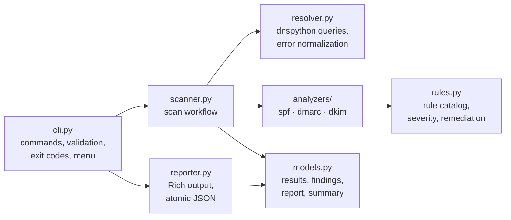

# TraceDNS

**A modular Python-based cybersecurity utility for DNS record analysis and evidence-based assessment of domain and email-security configurations.**

TraceDNS queries a domain's `A`, `AAAA`, `MX`, `NS`, and `TXT` records, runs basic SPF and DMARC checks, and optionally looks up a DKIM key for a selector you supply. Each result quotes the DNS data it is based on, has a transparent severity, and comes with a remediation recommendation. Results are shown in a Rich-powered terminal interface and can be exported as JSON.

It is intended for cybersecurity students, system administrators, and authorized security testers.

> **New to TraceDNS?** The [user guide](docs/user-guide.md) explains what it checks, how to run it, and how to read the results, in plain language.
>
> **Developer?** The [developer demo guide](docs/demo-guide.md) walks through every feature alongside the code and tests behind it. The design is described in [docs/architecture.md](docs/architecture.md).

---

## Contents

- [Problem statement](#problem-statement)
- [Aim and objectives](#aim-and-objectives)
- [Features](#features)
- [Scope](#scope)
- [Architecture](#architecture)
- [Technology stack](#technology-stack)
- [Installation](#installation)
- [Usage](#usage)
- [CLI reference](#cli-reference)
- [Sample output](#sample-output)
- [JSON report](#json-report)
- [Running tests](#running-tests)
- [Known limitations](#known-limitations)
- [Responsible use](#responsible-use)
- [License](#license)

## Problem statement

Email spoofing remains a common starting point for phishing. SPF, DMARC, and DKIM let domain owners publish policies that help receivers detect forged mail, but these policies live in DNS TXT records that are easy to get wrong. Common mistakes include two SPF records where one is required, a DMARC policy with an invalid tag, or a DKIM key that was revoked and never replaced. These mistakes are rarely visible until mail is spoofed or rejected.

TraceDNS gives a quick, readable, evidence-backed view of these configurations. It also states clearly where its checks stop.

## Aim and objectives

**Aim:** a lightweight, reliable DNS security assessment tool that identifies common DNS configuration weaknesses and email-authentication policy issues.

1. Retrieve A, AAAA, MX, NS, and TXT records.
2. Perform basic SPF and DMARC configuration checks.
3. Support optional DKIM record lookups using a user-supplied selector.
4. Identify missing records, malformed configurations, and duplicate SPF records.
5. Classify findings and provide evidence-based remediation advice.
6. Display results through Rich and export structured JSON.
7. Handle DNS errors predictably, and test the application with pytest.
8. Provide reproducible installation and usage instructions.

## Features

- **DNS record lookup** for `A`, `AAAA`, `MX`, `NS`, and `TXT`, with finite, configurable timeouts.
- **Precise query outcomes:** records found, no records (`NOERROR`/no data), `NXDOMAIN`, timeout, `SERVFAIL`, `REFUSED`, and other errors are all reported separately. A missing record is never confused with a failed query.
- **Basic SPF checks:** presence, multiple records, term syntax (mechanisms, qualifiers, `ip4`/`ip6` networks, CIDR lengths, duplicate modifiers), the `all` qualifier, missing `all`/`redirect`, terms after `all`, and use of `ptr`.
- **Basic DMARC checks:** presence, duplicate records, version tag, required `p=` tag and its value, malformed or duplicate tags, `sp`/`pct`/`adkim`/`aspf` values, plus observations for `p=none`, `pct<100`, missing `rua`, and a weaker `sp`.
- **Optional DKIM lookup** at `<selector>._domainkey.<domain>`: key presence, revoked keys, malformed tags, invalid base64, unknown key types, and testing mode.
- **Structured findings** with a stable ID, rule ID, status, severity, evidence, and recommendation. Severity comes from a central rule catalog, not from the UI.
- **Branded terminal interface:** banner, live stage progress, records table, finding panels, and a summary. Colors adapt to the terminal and output stays readable when redirected.
- **Interactive welcome menu** when run with no command in a terminal.
- **JSON export** to a file (written atomically, never silently overwritten) or to stdout in a JSON-only mode for scripts.
- **Meaningful exit codes** that separate "issues found" from "the scan itself failed".

## Scope

**Included in V1:** everything listed under [Features](#features).

**Explicitly excluded from V1:**

- Full DNSSEC chain-of-trust validation
- Exhaustive SPF evaluation (following `include`/`redirect`, the 10-lookup limit, macro expansion)
- Complete DMARC conformance testing and organizational-domain fallback
- Automatic DKIM selector discovery
- Zone transfers, subdomain enumeration, exploitation, or takeover attempts
- Web dashboard, API, database, scan history, monitoring, or alerting
- SIEM integration, threat-intelligence enrichment, and AI or opaque risk scoring

## Architecture



| Module | Responsibility |
|---|---|
| `cli.py` | Typer commands, option parsing, input validation, exit codes, welcome menu |
| `scanner.py` | Runs the queries each check needs (each once), applies analyzers, builds the report |
| `resolver.py` | Domain and selector validation, DNS queries, mapping every outcome to a status |
| `analyzers/spf.py` | Basic SPF checks |
| `analyzers/dmarc.py` | Basic DMARC checks |
| `analyzers/dkim.py` | Selector-based DKIM lookup and basic key-record checks |
| `rules.py` | Central catalog of rule IDs, statuses, severities, and recommendations |
| `models.py` | Dataclasses for DNS results, findings, and reports; summary counts |
| `reporter.py` | Banner, progress, tables, panels, summary, and JSON serialization |

Analyzers and the resolver never print. The reporter never queries DNS or assigns severity. See [docs/architecture.md](docs/architecture.md) for the data flow, schemas, error semantics, and full rule catalog.

```text
TraceDNS/
├── src/tracedns/
│   ├── __init__.py
│   ├── cli.py
│   ├── scanner.py
│   ├── resolver.py
│   ├── models.py
│   ├── rules.py
│   ├── reporter.py
│   └── analyzers/
│       ├── __init__.py
│       ├── common.py
│       ├── spf.py
│       ├── dmarc.py
│       └── dkim.py
├── tests/
├── examples/sample-report.json
├── docs/
│   ├── user-guide.md
│   ├── demo-guide.md
│   └── architecture.md
├── pyproject.toml
├── README.md
└── LICENSE
```

## Technology stack

| Technology | Purpose |
|---|---|
| [Python](https://www.python.org/) 3.11+ | Core language |
| [Typer](https://typer.tiangolo.com/) | CLI commands and options |
| [Rich](https://rich.readthedocs.io/) | Terminal presentation |
| [dnspython](https://www.dnspython.org/) | DNS resolution |
| [pytest](https://docs.pytest.org/) | Automated tests (development) |
| [Ruff](https://docs.astral.sh/ruff/) | Linting and formatting (development) |

JSON serialization uses the standard library. There are no other runtime dependencies.

## Installation

### Prerequisites

- Python **3.11 or newer**
- `git`
- Network access to a DNS resolver (only for real scans, not for the test suite)

### Windows (PowerShell)

```powershell
git clone https://github.com/PranavY-01/TraceDNS.git
cd TraceDNS
python -m venv .venv
.venv\Scripts\Activate.ps1
python -m pip install --upgrade pip
python -m pip install -e ".[dev]"
```

If PowerShell blocks the activation script, run `Set-ExecutionPolicy -Scope CurrentUser RemoteSigned` once, or call `.venv\Scripts\python.exe` directly.

### Linux and macOS

```bash
git clone https://github.com/PranavY-01/TraceDNS.git
cd TraceDNS
python3 -m venv .venv
source .venv/bin/activate
python -m pip install --upgrade pip
python -m pip install -e ".[dev]"
```

`.[dev]` also installs pytest and Ruff. To install only the runtime dependencies, use `python -m pip install -e .`.

Confirm the install:

```bash
tracedns --version
```

## Usage

```bash
# Welcome screen (interactive menu when run in a terminal)
tracedns

# Default scan: all record types, SPF and DMARC (DKIM is skipped without a selector)
tracedns scan example.com

# Query selected record types (comma-separated or repeated)
tracedns scan example.com --record A,MX
tracedns scan example.com -r A -r AAAA

# Run selected checks, or none for a records-only lookup
tracedns scan example.com --checks spf,dmarc
tracedns scan example.com --checks none

# Look up a DKIM key for a known selector
tracedns scan example.com --dkim-selector selector1

# Save a JSON report (refuses to replace an existing file without --overwrite)
tracedns scan example.com --json report.json
tracedns scan example.com --json report.json --overwrite

# JSON only, on stdout, for scripts and pipelines
tracedns scan example.com --json - > report.json
```

**Input rules.** TraceDNS accepts bare, fully qualified domain names. Input is case-insensitive, a trailing dot is allowed, and internationalized names are converted to their `xn--` form. URLs, paths, ports, e-mail addresses, IP addresses, and single-label names (such as `localhost` or internal hostnames) are rejected.

**Finding your DKIM selector.** Open the headers of a message sent from the domain and find the `DKIM-Signature` header. The selector is the value of its `s=` tag.

### Interactive menu

Running `tracedns` (or `tracedns welcome`) in a terminal shows the banner and a menu:

1. **Scan a domain:** prompts for a domain and an optional DKIM selector, then runs the default scan.
2. **Inspect DNS records:** prompts for a domain and queries records only.
3. **Help and usage:** shows the command reference and exit codes.
4. **Exit**

Invalid answers are re-asked, a blank domain returns to the menu, and Ctrl+C exits cleanly. When stdin or stdout is not a terminal, TraceDNS prints the banner and exits without waiting for input.

For a non-technical walkthrough, see the [user guide](docs/user-guide.md). For a feature-by-feature tour that maps each behaviour to its code and tests, see the [developer demo guide](docs/demo-guide.md).

## CLI reference

```text
tracedns [--version | -V] [--help | -h]
tracedns welcome
tracedns scan DOMAIN [OPTIONS]
```

| Option | Description | Default |
|---|---|---|
| `-r, --record TYPES` | Record types: `A`, `AAAA`, `MX`, `NS`, `TXT`. Comma-separated or repeated. | all five |
| `-c, --checks CHECKS` | Checks: `spf`, `dmarc`, `dkim`, or `none`. Comma-separated or repeated. | `spf,dmarc,dkim` |
| `-s, --dkim-selector SELECTOR` | DKIM selector to look up. Adds the `dkim` check. | none (DKIM skipped) |
| `-j, --json PATH` | Write a JSON report to `PATH`; `-` writes JSON only to stdout. | no report |
| `--overwrite` | Allow replacing an existing report file. | off |
| `-t, --timeout SECONDS` | Maximum time per DNS query (0.5–60). | `5.0` |
| `-v, --verbose` | Show a traceback for unexpected internal errors. | off |

Checks fetch the names they need even if you don't list `TXT` with `--record`. SPF reads the domain's TXT records, DMARC queries `_dmarc.<domain>`, and DKIM queries `<selector>._domainkey.<domain>`. These queries appear in the records table and the JSON report.

### Exit codes

| Code | Meaning |
|---|---|
| `0` | Scan completed. No finding above `info` and no inconclusive check. |
| `1` | Scan completed with at least one `low`, `medium`, or `high` finding, or an inconclusive check (for example, the domain does not exist). |
| `2` | Invalid input: domain, selector, option value, or report path (existing file without `--overwrite`, missing directory). Nothing is queried. |
| `3` | Operational failure: at least one DNS query failed (scan is `partial` or `failed`), the report could not be written, or an unexpected error occurred. |
| `130` | Interrupted with Ctrl+C. No report is written. |

`info` observations such as `p=none` or `~all` are shown, but they do not change the exit code on their own.

### Severity and status

Each entry in the assessment has a **status**: `pass`, `finding`, `error` (the check's DNS query failed), `inconclusive` (for example, the domain does not exist), or `skipped` (for example, no DKIM selector).

Only `finding` entries carry a **severity**:

| Severity | Used for |
|---|---|
| `high` | A policy that explicitly authorizes every sender (`+all`) |
| `medium` | Missing or invalid SPF/DMARC records, duplicate records, a missing DMARC policy, or a DKIM record with no key |
| `low` | Weak but valid settings (`?all`, no `all`, `ptr`), malformed optional tags, missing or revoked DKIM keys for the given selector |
| `info` | Observations that are often deliberate: `~all`, `p=none`, `pct<100`, no `rua`, DKIM testing mode |

TraceDNS does not produce an aggregate risk score. The full rule catalog is in [docs/architecture.md](docs/architecture.md#rule-catalog).

## Sample output

The excerpt below is genuine output from `tracedns scan example.com --checks spf,dmarc`. It was captured on 24 October 2026 with output redirected, so colors are not shown. Live DNS data changes over time.

```text
TRACEDNS v1.0.0 · DNS INTELLIGENCE · SECURITY AUDITING

 example.com  ─────────────────────────────────────────────────────────────────────────
  records A, AAAA, MX, NS, TXT  ·  checks spf, dmarc  ·  timeout 5s

  ✓ Validating target       example.com
  ✓ Querying DNS records    5 queries, 5 with records
  ✓ Analyzing SPF           passed
  ✓ Analyzing DMARC         passed with 1 observation(s)
  ✓ Building report         3 assessment result(s)

 ...records table and finding panels...

┌─  INFO  DMARC aggregate reporting is not configured  ───────────────────────────────┐
│ There is no 'rua=' tag, so you will not receive aggregate reports showing which     │
│ sources send mail using this domain.                                                │
│                                                                                     │
│ Evidence                                                                            │
│   › DMARC record: v=DMARC1;p=reject;sp=reject;adkim=s;aspf=s                        │
│                                                                                     │
│ Recommendation                                                                      │
│   Add 'rua=mailto:<address>' to receive aggregate reports.                          │
└───────────────────────────────────────────────────────────────  DMARC-009 · dmarc  ─┘

┌─  Scan summary  ─────────────────────────────────────────────────────────────┐
│  Target       example.com                                                    │
│  Status       completed                                                      │
│  Queries      6 attempted · 6 completed · 0 failed                           │
│  Assessments  2 passed · 1 findings · 0 errors · 0 inconclusive · 0 skipped  │
│  Severity     0 high · 0 medium · 0 low · 1 info                             │
│  Duration     0.09s                                                          │
└──────────────────────────────────────────────────────────────────────────────┘
```

### Capturing screenshots

To add screenshots, take them from a real run. Do not use edited or mocked output.

1. Use a dark terminal theme (Windows Terminal, iTerm2, GNOME Terminal) with a true-color profile and a width of at least 100 columns.
2. Run `tracedns` for the welcome screen, and `tracedns scan <your-domain>` for a full scan.
3. Save the images in `docs/images/` and reference them from this section, noting the command and date for each.

## JSON report

Every report has seven top-level fields: `schema_version`, `tool`, `target`, `scan`, `dns_results`, `findings`, `summary`. A report stays valid when checks fail: failed queries appear with their status and error, and the scan status becomes `partial` or `failed`.

```json
{
  "schema_version": "1.0",
  "tool": { "name": "TraceDNS", "version": "1.0.0" },
  "target": { "domain": "example.com" },
  "scan": {
    "started_at": "2026-10-24T13:33:27.417497+00:00",
    "finished_at": "2026-10-24T13:33:27.418497+00:00",
    "duration_seconds": 0.0,
    "status": "completed",
    "record_types": ["A", "AAAA", "MX", "NS", "TXT"],
    "checks": ["spf", "dmarc", "dkim"],
    "dkim_selector": "s1",
    "timeout_seconds": 5.0
  },
  "dns_results": [
    {
      "query_name": "_dmarc.example.com",
      "record_type": "TXT",
      "status": "success",
      "records": ["v=DMARC1; p=none"],
      "error": null
    }
  ],
  "findings": [
    {
      "id": "DMARC-007:_dmarc.example.com",
      "category": "email-authentication",
      "check": "dmarc",
      "status": "finding",
      "severity": "info",
      "title": "DMARC policy is monitoring-only (p=none)",
      "description": "'p=none' asks receivers to take no action on failing mail. ...",
      "evidence": ["DMARC record: v=DMARC1; p=none"],
      "recommendation": "Review aggregate reports, then move to 'p=quarantine' or 'p=reject' ...",
      "rule_id": "DMARC-007"
    }
  ],
  "summary": {
    "queries_attempted": 7,
    "queries_completed": 7,
    "queries_failed": 0,
    "assessments_total": 6,
    "passed": 3,
    "findings_total": 3,
    "findings_by_severity": { "high": 0, "medium": 0, "low": 0, "info": 3 },
    "errors": 0,
    "inconclusive": 0,
    "skipped": 0
  }
}
```

The JSON above is shortened. [`examples/sample-report.json`](examples/sample-report.json) is a complete report. Both are **illustrative fixtures**: they were generated by running TraceDNS against the controlled DNS responses used in the test suite (documentation addresses such as `192.0.2.10`), not from a live scan.

**Count semantics:** `findings_total` and `findings_by_severity` count only entries with status `finding`. `assessments_total` counts every entry in `findings`. `queries_completed` counts queries that got a definitive answer (`success`, `not_found`, `nxdomain`). Each item is counted once.

## Running tests

```bash
python -m pytest           # run the test suite
ruff check .               # lint
ruff format --check .      # formatting
```

The suite needs no network access. A fixture blocks sockets for every test, and DNS responses come from a fake resolver backend that returns real dnspython record objects and raises real dnspython exceptions. It covers:

- **Resolver:** successful, multi-record, and empty answers; NXDOMAIN; timeout; SERVFAIL; REFUSED; network failure; unexpected exceptions; TXT chunk joining; name validation.
- **SPF:** single, missing, and multiple records; unrelated TXT records; qualifier rules; malformed and valid syntax variants.
- **DMARC:** valid, missing, and duplicate records; version and policy errors; tag order and whitespace; malformed tags; DNS failure versus no record.
- **DKIM:** selector found, missing, query failure, invalid selector, skipped, revoked or malformed keys, hostile record contents treated as data.
- **Reporter:** finding display, severity styling, empty results, markup and escape-sequence injection, JSON schema, summary counts, existing files, write failures, interrupted writes.
- **CLI:** help and version, valid and invalid input, record and check selection, DKIM, JSON file and stdout modes, every exit code, Ctrl+C, the welcome screen, and the interactive menu.

**Optional live smoke test** (not part of the suite; use a domain you are authorized to assess):

```bash
tracedns scan example.com --json - | python -m json.tool > /dev/null && echo "valid JSON"
```

## Known limitations

- **SPF:** `include` and `redirect` targets are not followed, the 10-DNS-lookup limit is not evaluated, and macros are not expanded. A `pass` means "no issues found by these basic checks", not "SPF evaluates correctly for every sender".
- **DMARC:** if `_dmarc.<subdomain>` has no record, TraceDNS does not look up the organizational domain, so a policy inherited from the parent domain is not detected. Report URIs and external-destination authorization are not validated.
- **DKIM:** only the selector you supply is checked. Finding a key does not prove the domain signs mail with it or that signatures verify. Not finding one does not mean the domain lacks DKIM.
- **Resolver view:** results reflect what your configured resolver returns at scan time. Split-horizon DNS, caching, and propagation delays can produce different answers elsewhere.
- **No DNSSEC validation**, and no checks of record types other than A, AAAA, MX, NS, and TXT.
- **Policy, not behaviour:** TraceDNS reads published DNS policy. It does not test whether receivers enforce it, measure deliverability, or determine whether a domain has been spoofed or compromised.

## Responsible use

TraceDNS sends ordinary DNS queries with finite timeouts, one query per name and record type. It does not enumerate subdomains, attempt zone transfers, or exploit anything. Even so:

- Assess only domains you own or have explicit permission to assess.
- Treat results as configuration observations, not proof of compromise or exploitability.
- Retrieved DNS data is treated as untrusted input. It is parsed as text, never executed, and control characters and markup are escaped before display.

## License

TraceDNS is released under the [MIT License](LICENSE). Copyright (c) 2026 PranavY-01.
