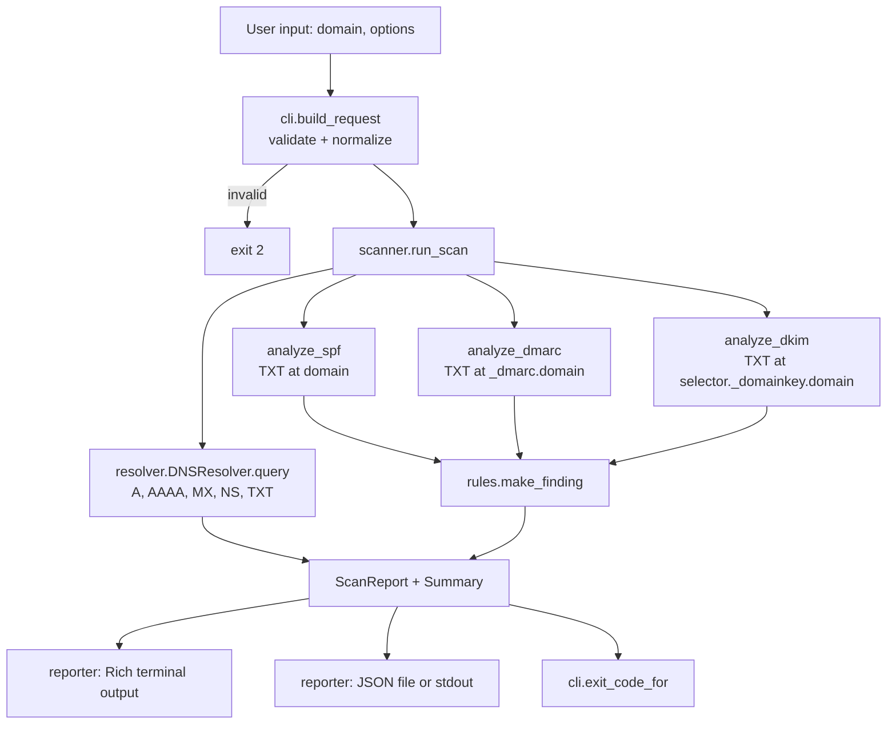

# TraceDNS architecture

This document describes how TraceDNS V1 is put together: what each module is responsible for, how data flows through a scan, the schemas it produces, how errors are classified, and how it is tested.

## Design principles

- **Separate execution from assessment.** Whether a DNS query worked is recorded separately from what a security check concluded. A timeout is never reported as a missing record.
- **Every result comes from evidence.** Each finding quotes the DNS data (or query outcome) it was based on.
- **Severity is decided in one place.** Analyzers name a rule; the rule catalog supplies status, severity, wording, and remediation.
- **No layer reaches past its neighbour.** Analyzers and the resolver never print. The reporter never queries DNS or decides severity.
- **DNS data is untrusted.** Record contents are parsed as text, never executed, and escaped before they reach the terminal.

## Components

```text
src/tracedns/
├── cli.py          Typer commands, input validation, exit codes, welcome menu
├── scanner.py      Scan workflow: runs queries and analyzers, builds the report
├── resolver.py     Name validation, dnspython queries, error normalization
├── analyzers/
│   ├── common.py   Tag parsing and evidence helpers shared by analyzers
│   ├── spf.py      Basic SPF checks
│   ├── dmarc.py    Basic DMARC checks
│   └── dkim.py     Selector-based DKIM lookup and basic key-record checks
├── rules.py        Rule catalog: IDs, status, severity, wording, remediation
├── models.py       Dataclasses and enums for results, findings, and reports
└── reporter.py     Rich rendering and atomic JSON serialization
```

| Module | Responsibility | Does not |
|---|---|---|
| `cli.py` | Parses options, validates input, chooses output mode, maps reports to exit codes, runs the menu | Contain analysis logic |
| `scanner.py` | Decides which queries each check needs, runs each `(name, type)` query once, calls analyzers, builds `ScanReport` | Print (it reports progress through an observer) |
| `resolver.py` | Validates domains and selectors, queries dnspython with finite timeouts, returns `DNSResult` | Raise dnspython exceptions to callers |
| `analyzers/*` | Turn `DNSResult` objects into `Finding` objects | Query DNS or print |
| `rules.py` | Own every rule ID, status, severity, title, description, and recommendation | Know about DNS or the terminal |
| `models.py` | Define the data contract and JSON conversion; compute summary counts and scan status | Perform I/O |
| `reporter.py` | Render the banner, progress lines, tables, panels, and summary; write JSON atomically | Change results |

`scanner.py` is not in the original design outline. It was added so that the `scan` command and the interactive menu share one tested workflow instead of duplicating it in command handlers.

## Data flow



1. `cli.build_request` normalizes the domain (lower case, trailing dot removed, IDN converted to ASCII) and selector, and parses `--record` and `--checks`. If `--json PATH` is used, the path is checked before any query is sent.
2. `scanner.run_scan` queries each requested record type at the domain. Each check then fetches the name it needs, reusing earlier results: SPF uses the domain's TXT, DMARC uses `_dmarc.<domain>` TXT, and DKIM uses `<selector>._domainkey.<domain>` TXT.
3. If any query for the domain itself returns NXDOMAIN, the target does not exist, and DMARC and DKIM are reported as inconclusive rather than "missing".
4. Analyzers return findings created through `rules.make_finding`.
5. The report is assembled with `models.build_summary` and `models.scan_status_for`.
6. The reporter renders it and/or writes JSON. `cli.exit_code_for` maps it to an exit code.

## Result schemas

### DNS query result (`dns_results[]`)

| Field | Type | Meaning |
|---|---|---|
| `query_name` | string | Name queried, without trailing dot |
| `record_type` | string | `A`, `AAAA`, `MX`, `NS`, or `TXT` |
| `status` | string | Query status (see below) |
| `records` | string[] | Normalized values, sorted (MX by numeric preference) |
| `error` | string or null | Human-readable reason for non-success statuses |

Record normalization: A/AAAA are addresses; MX is `"<preference> <exchange>"`; NS is the target host; TXT joins a record's character-strings with no separator (how SPF, DMARC, and DKIM consumers reassemble long records). Invalid UTF-8 bytes are kept as `\xNN` escapes.

### Finding (`findings[]`)

| Field | Type | Meaning |
|---|---|---|
| `id` | string | `<rule_id>:<query name>`; stable and unique within a report |
| `category` | string | `email-authentication` |
| `check` | string | `spf`, `dmarc`, or `dkim` |
| `status` | string | `pass`, `finding`, `error`, `inconclusive`, `skipped` |
| `severity` | string or null | `info`, `low`, `medium`, `high` for `finding`; otherwise `null` |
| `title` | string | Short statement of the result |
| `description` | string | What was observed and what it means |
| `evidence` | string[] | Records or query outcomes the result is based on |
| `recommendation` | string | Suggested remediation |
| `rule_id` | string | Catalog rule, e.g. `DMARC-007` |

### Report

```text
schema_version   "1.0"
tool             { name, version }
target           { domain }
scan             { started_at, finished_at, duration_seconds, status, record_types,
                   checks, dkim_selector, timeout_seconds }
dns_results      [DNS query result]
findings         [Finding]
summary          { queries_attempted, queries_completed, queries_failed,
                   assessments_total, passed, findings_total, findings_by_severity,
                   errors, inconclusive, skipped }
```

Timestamps are ISO 8601 in UTC with an explicit `+00:00` offset.

**Summary count semantics.** Each query and each finding is counted exactly once.

- `queries_attempted` = number of entries in `dns_results`.
- `queries_completed` = queries with status `success`, `not_found`, or `nxdomain`. `queries_failed` = the rest.
- `assessments_total` = number of entries in `findings`, whatever their status.
- `findings_total` and `findings_by_severity` count only entries with status `finding`.
- `passed`, `errors`, `inconclusive`, `skipped` count entries with that status.

**Scan status.** `completed` when every query produced a definitive answer, `partial` when at least one failed and at least one completed, `failed` when all failed. An interrupted scan produces no report at all, so an incomplete scan is never written as `completed`.

## Error semantics

### Query status (resolver)

| Status | dnspython outcome | Completed? |
|---|---|---|
| `success` | Answer with records | yes |
| `not_found` | `NoAnswer` (NOERROR, no records of this type) | yes |
| `nxdomain` | `NXDOMAIN` | yes |
| `timeout` | `Timeout` / `LifetimeTimeout` | no |
| `servfail` | `NoNameservers` where a server answered SERVFAIL | no |
| `refused` | `NoNameservers` where servers answered REFUSED | no |
| `error` | Any other failure: network unreachable, no resolver configuration, malformed response, unexpected exception | no |

Each query has a finite lifetime (`--timeout`, default 5 s, range 0.5–60 s), with each individual nameserver attempt capped at 2 s. Retries happen only within that lifetime. One failed query does not stop other queries or checks.

### Assessment status (analyzers)

| Situation | Result |
|---|---|
| The check's query failed | `error` (`*-900`), no severity |
| The target domain is NXDOMAIN | `inconclusive` (`*-901`), no severity |
| No DKIM selector supplied | `skipped` (`DKIM-800`) |
| Record missing and the query completed | `finding` with a severity |
| Record present, no issue above INFO | `pass` (plus any INFO observations) |

### Input and runtime errors

| Situation | Behaviour | Exit code |
|---|---|---|
| Invalid domain, selector, record type, or check | Message on stderr, no queries sent | 2 |
| Report path exists (without `--overwrite`), is a directory, or its directory is missing | Message on stderr, no queries sent | 2 |
| Report cannot be written (permissions, disk) | Results still shown; message on stderr; no partial file | 3 |
| Any DNS query failed | Report marked `partial`/`failed` | 3 |
| Ctrl+C | Spinner stopped, message on stderr, no report written | 130 |
| Unexpected exception | One-line message on stderr; traceback only with `--verbose` | 3 |

Reports are written atomically: JSON goes to a temporary file in the destination directory, which is flushed, synced, and then renamed over the target. The temporary file is removed on any failure or interruption.

## Rule catalog

| Rule | Status | Severity | Condition |
|---|---|---|---|
| SPF-001 | finding | medium | TXT query completed, no `v=spf1` record |
| SPF-002 | finding | medium | More than one `v=spf1` record (RFC 7208 permerror) |
| SPF-003 | finding | medium | A term fails basic syntax |
| SPF-004 | finding | high | `+all` or bare `all` |
| SPF-005 | finding | low | `?all` |
| SPF-006 | finding | info | `~all` |
| SPF-007 | finding | low | No `all` and no `redirect=` |
| SPF-008 | finding | info | Mechanisms after `all`, or `redirect` alongside `all` |
| SPF-009 | finding | low | `ptr` mechanism used |
| SPF-100 | pass | – | One record, no issue above info |
| DMARC-001 | finding | medium | Query completed, no `v=DMARC1` record |
| DMARC-002 | finding | medium | More than one candidate record |
| DMARC-003 | finding | medium | First tag is not exactly `v=DMARC1` |
| DMARC-004 | finding | medium | No `p=` tag |
| DMARC-005 | finding | medium | `p=` not `none`/`quarantine`/`reject` |
| DMARC-006 | finding | low | Malformed segments, duplicate tags, invalid `sp`/`pct`/`adkim`/`aspf` |
| DMARC-007 | finding | info | `p=none` (monitoring-only) |
| DMARC-008 | finding | info | `pct` below 100 with an enforcing policy |
| DMARC-009 | finding | info | No `rua=` |
| DMARC-010 | finding | info | `sp=none` with an enforcing `p=` |
| DMARC-100 | pass | – | One valid record, no issue above info |
| DKIM-001 | finding | low | Query completed, no record at the selector |
| DKIM-002 | finding | medium | No `p=` tag |
| DKIM-003 | finding | low | Malformed tags, `v` not first/`DKIM1`, unknown `k`, non-base64 `p` |
| DKIM-004 | finding | low | Empty `p=` (revoked key) |
| DKIM-005 | finding | info | `t=y` testing flag |
| DKIM-006 | finding | low | More than one TXT record at the selector |
| DKIM-100 | pass | – | Key record with a valid public key |
| DKIM-800 | skipped | – | No selector supplied |
| `*-900` | error | – | The check's DNS query failed |
| `*-901` | inconclusive | – | Target domain does not exist |

## Terminal output

- A themed `Console` is created per command. Rich detects color depth (true color, 256, 16, none), honours `NO_COLOR`, and drops styling when output is redirected.
- Unicode glyphs and the block logo are used only when the output encoding is UTF-8. Otherwise ASCII equivalents are used, and unencodable characters are replaced rather than crashing.
- Progress is shown per stage. A spinner runs while a stage is working (interactive terminals only), and a status line is printed when it finishes, reflecting the actual outcome.
- In JSON-only mode (`--json -`) no Rich console writes to stdout; errors go to stderr.

## Testing approach

- **No network.** An autouse fixture in `tests/conftest.py` replaces socket `connect`, `sendto`, and `getaddrinfo` with functions that raise. Any accidental real query fails the test.
- **Controlled DNS.** `tests/helpers.py` provides a fake dnspython backend that returns real `dns.rdata` objects built from zone-file text, or raises real dnspython exceptions (`NXDOMAIN`, `NoAnswer`, `LifetimeTimeout`, `NoNameservers` with SERVFAIL/REFUSED/OSError entries).
- **Layers are tested in isolation.** Analyzer tests use `DNSResult` objects directly. Resolver tests use the fake backend. Reporter tests render to an in-memory console. CLI tests use Typer's `CliRunner` with `build_resolver` patched.
- **Live checks are manual.** Running TraceDNS against real domains is not part of the automated suite. Use domains you own or `example.com`.
